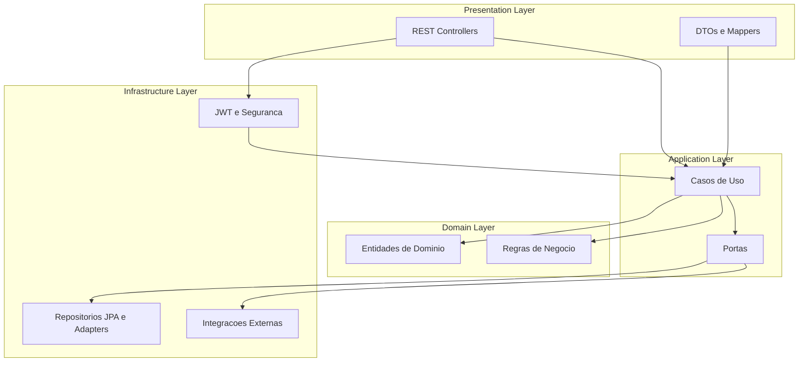
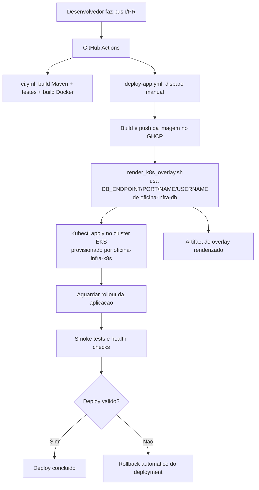
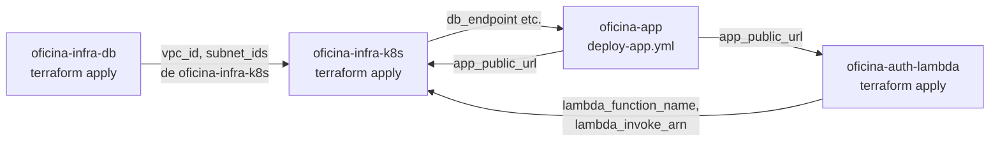

Oficina - Sistema de Gestão de Oficina Mecânica

[](https://sonarcloud.io/summary/new_code?id=gabrielivo01_oficina)
[](https://sonarcloud.io/summary/new_code?id=gabrielivo01_oficina)

Visão Geral

API REST do OS Service para clientes, veículos, ordens de serviço e autenticação JWT. Catálogo, estoque e execução pertencem ao [Execution Service](https://github.com/gabrielivo01/oficina-execution-service#readme); orçamentos e cobranças pertencem ao [Billing Service](https://github.com/gabrielivo01/oficina-billing-service#readme). O OS Service coordena o fluxo distribuído pela Saga.

Arquitetura

Tecnologias Principais
- **Java 21** - Linguagem de programação
- **Spring Boot 4.0.6** - Framework web
- **Spring Security + JWT** - Autenticação e autorização
- **Spring Data JPA** - Persistência de dados
- **H2 Database** - Banco de dados em memória (desenvolvimento)
- **SpringDoc OpenAPI** - Documentação automática da API
- **Maven** - Gerenciamento de dependências

Estrutura do Projeto
```
src/main/java/io/github/gabrielivo/oficina/
├── application/          # Camada de aplicação (casos de uso)
│   ├── cliente/         # Serviços de cliente
│   ├── ordemServico/    # Serviços de ordem de serviço
│   ├── usuario/        # Serviços de usuário
│   └── veiculo/        # Serviços de veículo
├── domain/             # Camada de domínio (entidades e regras)
│   ├── cliente/        # Entidades Cliente e Endereco
│   ├── ordemServico/   # Entidades OrdemServico, ItemOrdemServico
│   ├── usuario/       # Entidade Usuario
│   └── veiculo/       # Entidade Veiculo
├── infrastructure/     # Camada de infraestrutura
│   ├── security/      # Configurações de segurança JWT
│   └── seeder/        # Dados iniciais
└── presentation/       # Camada de apresentação (controllers REST)
    ├── auth/          # Autenticação
    ├── cliente/       # Endpoints de cliente
    ├── ordemServico/  # Endpoints de OS
    └── veiculo/      # Endpoints de veículo
```

Domínios de Negócio

1 Usuário 
- **Responsabilidade**: Autenticação e autorização no sistema
- **Atributos**: login, senha
- **Funcionalidades**: Login JWT, validação de credenciais

2 Cliente
- **Responsabilidade**: Representar os clientes da oficina
- **Atributos**: CPF, nome, telefone, endereço
- **Funcionalidades**: CRUD completo, validação de CPF único

3 Endereço 
- **Responsabilidade**: Informações de localização dos clientes
- **Atributos**: CEP, logradouro, número, complemento, bairro, cidade, UF
- **Relacionamento**: 1:1 com Cliente (cascade persist)

4 Veículo 
- **Responsabilidade**: Veículos dos clientes
- **Atributos**: placa, marca, modelo, ano
- **Relacionamento**: N:1 com Cliente
- **Regras**: Placa única no sistema

5 Ordem de Serviço
- **Responsabilidade**: Gerenciamento completo do workflow de serviços
- **Atributos**: cliente, veículo, status, valor total, itens
- **Relacionamento**: 1:N com ItemOrdemServico

6 Item de Ordem de Serviço
- **Responsabilidade**: Snapshot imutável dos serviços e peças informado pelo Execution Service ao concluir o diagnóstico pela Saga
- **Atributos**: descrição, tipo, valor, quantidade e identificador/nome da peça quando aplicável

8 Cobrança e pagamento
- **Responsabilidade**: orçamento, cobrança e integração com Mercado Pago no Billing Service.
- **Persistência**: documentos no MongoDB do Billing; o OS Service consome eventos da Saga.

Fluxos de Processamento

Autenticação JWT 
1. **Login**: Cliente envia login/senha
2. **Validação**: Sistema verifica credenciais
3. **Token**: Gera JWT com expiração de 30 minutos
4. **Acesso**: Cliente usa token em Authorization header

Estoque
- Catálogo, reservas, reposição e alertas de estoque são oferecidos pelo Execution Service.
- O OS Service não acessa o banco do Execution; recebe `DiagnosticoConcluido` pela Saga e mantém seu snapshot independente.

Validações de Negócio 
- **CPF único** por cliente
- **Placa única** por veículo
- **Transições de status** válidas na OS
- **Campos obrigatórios** em todas as entidades

Workflow de Ordem de Serviço

#Estados da Ordem de Serviço
```
RECEBIDA → EM_DIAGNOSTICO → AGUARDANDO_APROVACAO → EM_EXECUCAO → FINALIZADA → ENTREGUE
```

O OS Service cria a OS no estado `RECEBIDA` e inicia a Saga transacionalmente com a ordem e o comando
de diagnóstico na outbox. Execution mantém a fila de diagnóstico/reparo, catálogo e reservas; Billing
mantém orçamento, cobrança e integração de pagamento. Os serviços não acessam os bancos uns dos outros.

Como Executar

Pré-requisitos
- Java 21+
- Maven 3.6+

Executar em Desenvolvimento
```bash
# Compilar
./mvnw clean compile

# Executar testes
./mvnw test

# Executar aplicação (perfil local: H2 e segurança desligada; sem perfil a segurança fica LIGADA)
./mvnw spring-boot:run -Dspring-boot.run.profiles=local
```

Configurar hooks do Git (uma vez, após clonar)
```bash
./scripts/setup_git_hooks.sh
```
Isso habilita hooks locais (`.githooks/`) que bloqueiam commits com arquivos de segredo/config local (`.env`, `*.pem`, `*.key`, etc.), validam a compilação a cada commit e rodam a suíte de testes antes de cada push.

Testar e-mails localmente
```bash
# Subir o banco e o MailHog
docker compose up -d postgres mailhog

# Habilitar envio de e-mail
# no application.properties:
# app.mail.enabled=true
# app.mail.to=seu-email@dominio.com

# Acompanhar mensagens em
# http://localhost:8025
```

Acessar a Aplicação
- **API Base**: http://localhost:8080
- **Swagger UI**: http://localhost:8080/swagger-ui.html
- **API Docs**: http://localhost:8080/v3/api-docs

Dados Iniciais
A aplicação cria automaticamente:
- Usuário admin: `login=admin` | `senha=admin123`

API Endpoints

Autenticação
- `POST /auth/login` - Login e geração de token JWT (staff/admin, login e senha)
- `POST /auth/cpf` - Autenticação de clientes por CPF, via API Gateway + AWS Lambda
  (repositório separado `oficina-auth-lambda`) — não é um endpoint desta
  aplicação; o Lambda valida o CPF, consulta `GET /internal/clientes/{cpf}/status`
  e emite um JWT aceito pelos mesmos endpoints protegidos abaixo

Clientes
- `GET /clientes` - Listar todos
- `POST /clientes` - Criar novo
- `GET /clientes/{id}` - Buscar por ID
- `PUT /clientes/{id}` - Atualizar
- `DELETE /clientes/{id}` - Remover
- `PATCH /clientes/{id}/inativar` - Inativar cliente (bloqueia login por CPF)
- `PATCH /clientes/{id}/reativar` - Reativar cliente

Interno (uso servico-a-servico, não exposto publicamente)
- `GET /internal/clientes/{cpf}/status` - Existência/status do cliente; protegido
  pelo header `X-Internal-Api-Key` (`InternalApiKeyFilter`), consumido pelo Lambda
  de autenticação por CPF

Veículos
- `GET /veiculos` - Listar todos
- `POST /veiculos` - Criar novo
- `GET /veiculos/{id}` - Buscar por ID
- `PUT /veiculos/{id}` - Atualizar
- `DELETE /veiculos/{id}` - Remover

Ordens de Serviço
- `GET /ordens-servico?status=RECEBIDA&status=EM_DIAGNOSTICO&pagina=0&tamanho=20` - Listagem paginada
  (`{conteudo, pagina, tamanho, totalElementos, totalPaginas}`), ordenada por prioridade de status; sem
  `status`, só as OS ativas (exclui `FINALIZADA`, `ENTREGUE`, `CANCELADA`)
- `POST /ordens-servico` - Criar nova OS com cliente e veículo; diagnóstico e orçamento seguem pela Saga
- `GET /ordens-servico/{id}` - Buscar por ID
- `GET /ordens-servico/{id}/status` - Consultar status atual
- `GET /ordens-servico/{id}/historico` - Histórico de status (anterior, novo, data/hora, origem, motivo)
- `GET /ordens-servico/{id}/saga` - Consultar etapa, situação e histórico da Saga
- `POST /ordens-servico/{id}/entregar` - Registrar entrega após a OS ser finalizada
- `POST /ordens-servico/{id}/cancelar` - Solicitar cancelamento (corpo opcional `{"motivo": "..."}`; a Saga marca `CANCELADA` após as compensações)

Execution Service
- Catálogo, estoque, reservas e fila de execução: [README do serviço](https://github.com/gabrielivo01/oficina-execution-service#readme)
- Inclui `GET/POST/PUT/DELETE /pecas`, reposição/alertas e endpoints de tarefa em `/tarefas`.

Mensageria
- Contratos de todos os comandos e eventos da Saga (envelope, payload, produtor, consumidor, fila e exemplo):
  `documentacao/contratos_mensagens.md`; exemplos em `src/test/resources/contratos/*.json`, verificados por
  `ContratosMensagensTest`.
- O OS Service publica `StatusOrdemServicoAlterado` (outbox → `oficina.eventos`) a cada transição de status
  e o consome para notificar o cliente (ADR 0010). A topologia e contratos estão em
  `documentacao/contratos_mensagens.md`. Plataforma local:
  `docker compose -f ../oficina-infra-k8s/local/docker-compose.yml up -d --wait`.

## Saga Pattern

A Saga é **orquestrada pelo OS Service**: cada evento é validado pela máquina de estados, o status/histórico
da OS e os comandos resultantes são persistidos na mesma transação com outbox. Inbox e identificador da
mensagem tornam o consumo idempotente. Os participantes confirmam suas compensações antes de o fluxo
alcançar `CANCELADA`; após pagamento, o cancelamento estorna antes de liberar estoque. Em uma corrida
entre cancelamento e conclusão do reparo, `FINALIZADA` prevalece.

Escolhemos a orquestração para centralizar prazos, retries, estado e observabilidade do processo que já tem
a OS como fonte de verdade. Isso evita lógica de coordenação espalhada pelos participantes. Veja a
[justificativa no ADR 0005](./documentacao/adrs/0005-saga-orquestrada.md), os
[contratos de comandos/eventos](./documentacao/contratos_mensagens.md) e os
[diagramas de arquitetura e compensação](./documentacao/arquitetura_fase4.md).

| Etapa | Mensagem/decisão | Resultado ou compensação |
|---|---|---|
| Abertura e diagnóstico | `SolicitarDiagnostico` → `DiagnosticoIniciado` / `DiagnosticoConcluido` | Snapshot da OS e reserva de peças |
| Orçamento | `GerarOrcamento` → `OrcamentoGerado` → `OrcamentoAprovado` | Recusa libera a reserva e cancela a OS |
| Cobrança | `CriarCobranca` → `CobrancaCriada` → `PagamentoConfirmado` | Rejeição/timeout cancela cobrança quando aplicável, libera reserva e cancela a OS |
| Execução | `IniciarExecucao` → `ExecucaoIniciada` → `ExecucaoFinalizada` | Recusa estorna pagamento e libera a reserva |
| Cancelamento manual | `CancelarExecucao` quando necessário | Confirma cancelamento, estorna, libera reserva e conclui a compensação |

Exemplo de abertura de OS
```json
{
  "clienteId": "cliente-1",
  "veiculoId": "veiculo-1"
}
```

Exemplo de resposta de orçamento
```json
{
  "aprovado": true,
  "observacao": "Cliente aprovou o orçamento"
}
```

Cobranças são atendidas pelo [Billing Service](https://github.com/gabrielivo01/oficina-billing-service#readme); não há endpoint
de pagamento manual nem tabela de pagamento neste serviço.

## Testes

| Tipo | Onde | Roda em |
|---|---|---|
| Unitários (domínio, serviços com Mockito, controllers) | `src/test/java/**` | `./mvnw verify` |
| Contrato das mensagens da Saga | `contratos/ContratosMensagensTest` + `src/test/resources/contratos/*.json` | `./mvnw verify` |
| Saga em memória (orquestrador, outbox e inbox reais; Execution e Billing falsos) | `saga/memoria/SagaEmMemoriaTest` | `./mvnw verify` |
| BDD (Cucumber, português): fluxo completo e as 3 compensações | `src/test/resources/features/saga_ordem_servico.feature` | `./mvnw verify` (relatório em `target/cucumber-reports/`) |
| Integração com PostgreSQL e RabbitMQ reais (Testcontainers) | `integracao/*IT` | `./mvnw verify -Pintegracao` (exige Docker) |

```bash
./mvnw verify                                  # testes, ArchUnit, Spotless e JaCoCo (cobertura mínima de 80%)
./mvnw verify -Pintegracao                     # + testes de integração (Docker)
./mvnw test -Dtest="*OrdemServico*"            # um conjunto de testes
```

A estratégia de testes está no [ADR 0013](./documentacao/adrs/0013-estrategia-de-testes-em-dois-planos.md).

## Demonstração e qualidade

- Collection e environment Postman: [`documentacao/postman/`](./documentacao/postman/). O environment `local` espera o
  OS Service em `:8080`, o Execution em `:8081` (rodar com `SERVER_PORT=8081`) e o Billing em `:8082` (porta padrão).
  O fluxo segue a ordem das pastas; após o pagamento, o reparo já começa `EM_ANDAMENTO` no Execution.
- Roteiro de apresentação (até 15 minutos): [`documentacao/roteiro_video.md`](./documentacao/roteiro_video.md).

### CI/CD (Fase 4)

Cada microsserviço tem pipelines próprios no GitHub Actions:

- **CI** (`.github/workflows/ci.yml`, em PR e push na `main`): build, `./mvnw verify` (testes, ArchUnit, Spotless e
  JaCoCo ≥ 80%), análise no [SonarCloud](https://sonarcloud.io/summary/new_code?id=gabrielivo01_oficina) com espera
  do Quality Gate, build da imagem Docker e, num job separado, os testes de integração (`-Pintegracao`).
- **CD** (`.github/workflows/cd.yml`, em push na `main`): publica a imagem no GHCR, sobe um cluster Kubernetes
  (kind) com a plataforma do [`oficina-infra-k8s`](https://github.com/gabrielivo01/oficina-infra-k8s) (RabbitMQ,
  OTel/Jaeger, Prometheus/Grafana), implanta os 3 serviços, espera os rollouts e health checks e roda o smoke test
  E2E da Saga (abre uma OS e a acompanha até `FINALIZADA`). Em falha, publica os logs dos pods como artefato.
- **Branch `main` protegida** nos 3 serviços: merge só por pull request, com os dois jobs do CI obrigatórios
  (incluindo o Quality Gate) e sem push direto, inclusive para administradores
  (`scripts/proteger_branch_main.sh`).

Fluxo de uma mudança:

```bash
git checkout -b minha-mudanca && git push origin minha-mudanca
gh pr create --fill          # o CI roda no PR; o merge só é liberado com as checagens verdes
gh pr merge --squash
```

Segurança

JWT Authentication
- **Token Expiration**: 30 minutos
- **Header**: `Authorization: Bearer {token}`
- **Endpoints Protegidos**: Todos exceto login, autenticação interna e documentação
- **Dois tipos de token**: emitido via `/auth/login` (staff, claim `tipo` ausente
  → tratado como `USUARIO`) ou via o Lambda de CPF (claim `tipo=CLIENTE`,
  `sub`=CPF) — `JwtAuthFilter` resolve cada um contra `UserDetailsServiceImpl`
  ou `ClienteUserDetailsService`, respectivamente; um cliente inativado deixa
  de autenticar mesmo com token ainda não expirado

Endpoints Públicos
- `/` - Página inicial
- `/auth/**` - Autenticação
- `/internal/**` - Uso servico-a-servico, protegido por `X-Internal-Api-Key`
  (não por JWT) quando `app.security.enabled=true` (padrão; só o perfil `local` desliga). A chave é comparada
  em tempo constante e, se não estiver configurada, nenhuma chamada interna passa
- `/v3/api-docs/**` - Documentação OpenAPI
- `/swagger-ui/**` - Interface Swagger
- `/actuator/**` - Health checks

Banco de Dados

H2 (Desenvolvimento)
- **URL**: `jdbc:h2:mem:oficina`
- **Console**: http://localhost:8080/h2-console
- **Username**: `sa`
- **Password**: *(vazio)*

Configuração JPA / schema
- **Migrations**: Flyway (`src/main/resources/db/migration`); `V1__baseline.sql` reproduz o schema que o
  Hibernate criava. Bancos já existentes recebem baseline automático na V1 (`spring.flyway.baseline-on-migrate`)
- **DDL Auto**: `validate` em todos os perfis (o Hibernate só confere o mapeamento contra o schema migrado)
- **Dialect**: detectado pela URL (H2 local, PostgreSQL nos perfis `docker`/`k8s`)
- **Show SQL**: Desabilitado em produção

Monitoramento

Spring Boot Actuator
- **Health Check**: `/actuator/health`
- **Info**: `/actuator/info`
- **Metrics**: `/actuator/metrics`

Configurações Importantes

application.properties
```properties
# JWT
jwt.expiration=1800000
jwt.secret=sua-chave-secreta-deve-ter-pelo-menos-256-bits-aqui

# Banco H2
spring.datasource.url=jdbc:h2:mem:oficina;DB_CLOSE_DELAY=-1;DB_CLOSE_ON_EXIT=FALSE
spring.jpa.hibernate.ddl-auto=validate
spring.flyway.baseline-on-migrate=true

# Swagger
springdoc.api-docs.path=/v3/api-docs
springdoc.swagger-ui.path=/swagger-ui.html
```

Deploy

Para Produção
1. **Banco**: Configurar MySQL/PostgreSQL
2. **JWT Secret**: Usar chave segura de 256+ bits
3. **Profiles**: Criar profile `prod`
4. **Build**: `./mvnw clean package -Dspring.profiles.active=prod`

Docker (Opcional)
```yaml
# docker-compose.yml
version: '3.8'
services:
  oficina:
    build: .
    ports:
      - "8080:8080"
    environment:
      - SPRING_PROFILES_ACTIVE=prod
```

Parte 2 - Entregas Realizadas Hoje

1. APIs criadas

- Abertura de Ordem de Serviço (OS): recebimento de dados de cliente, veículo, serviços e peças, retornando identificação única da OS.
- Consulta de status da OS: situação atual da OS, contemplando Recebida, Diagnóstico, Aguardando Aprovação, Execução, Finalizada e Entregue.
- Aprovação de orçamento: endpoint para receber notificações externas de aprovação ou recusa de orçamento do cliente.
- Listagem de ordens de serviço com as regras:
- Ordenação por status: Em Execução > Aguardando Aprovação > Diagnóstico > Recebida.
- Mais antigas primeiro.
- Exclusão lógica da listagem para OS finalizadas e entregues.
- Atualização de status da OS via ferramenta externa, como e-mail.

2. Refatoração arquitetural

- Refatoração do projeto com foco em arquitetura baseada em Clean Architecture.
- Melhor separação de responsabilidades entre domínio, aplicação, apresentação e infraestrutura.

Diagrama da arquitetura de código (Clean Architecture)



3. CI/CD e automação de infraestrutura

- Configuração de CI/CD com GitHub Actions.
- Uso de scripts de automação para deploy.
- **Após o split em 4 repositórios** (ver
  `documentacao/plano_implementacao.md`, seção 5), este repositório
  (`oficina-app`) não possui mais Terraform próprio — ele só builda a imagem
  e faz deploy dos manifests Kubernetes num cluster/banco já provisionados
  pelos repositórios `oficina-infra-k8s` e `oficina-infra-db`.

Diagrama do fluxo de deploy (`oficina-app`)



Diagrama de dependência entre os 4 repositórios (deploy completo):



Parte 3 - Instruções de Execução e Entrega

Instruções para execução local

```bash
# instalar dependências e validar projeto
./mvnw clean test

# executar API localmente (perfil local desliga a segurança, que é ligada por padrão)
./mvnw spring-boot:run -Dspring-boot.run.profiles=local
```

Endpoints locais:
- API: http://localhost:8080
- Swagger UI: http://localhost:8080/swagger-ui.html
- OpenAPI JSON: http://localhost:8080/v3/api-docs

Instruções para deploy em Kubernetes

```bash
# deploy direto no ambiente dev
kubectl apply -k k8s/overlays/dev
```

Opção com render/deploy usando os outputs do repositório `oficina-infra-db`
(este repositório não possui Terraform próprio — ver "Provisionamento da
infraestrutura" abaixo):

```bash
DB_ENDPOINT="<endpoint-rds>" DB_PORT="5432" DB_NAME="oficina_db" DB_USERNAME="postgres" \
scripts/deploy_k8s_overlay.sh hml
```

Provisionamento da infraestrutura (Terraform)

A infraestrutura deste projeto está dividida em 4 repositórios (ver
`documentacao/plano_implementacao.md`, seção 5, e
`documentacao/diagrama_componentes.md`); `oficina-app` não provisiona nada
via Terraform. Ordem de aplicação:

1. `oficina-infra-k8s` — cluster EKS + API Gateway (`terraform apply`).
2. `oficina-infra-db` — RDS PostgreSQL, usando `vpc_id`/`subnet_ids` do passo 1.
3. `oficina-auth-lambda` — function de autenticação por CPF (`terraform apply`).
4. Deploy deste repositório (`oficina-app`) usando os outputs dos passos 1–2.
5. Publicar o `app_public_url` (hostname do `Service` `oficina-app-lb`) de
   volta nos repositórios `oficina-infra-k8s` e `oficina-auth-lambda` e
   reaplicar os dois.

Link para a collection completa das APIs

- Swagger UI: http://localhost:8080/swagger-ui.html
- OpenAPI (importável no Postman/Insomnia): http://localhost:8080/v3/api-docs
- Em ambiente remoto, substitua `localhost:8080` pelo host publicado.

Licença

Este projeto está sob a licença MIT. Veja o arquivo `LICENSE` para mais detalhes.
