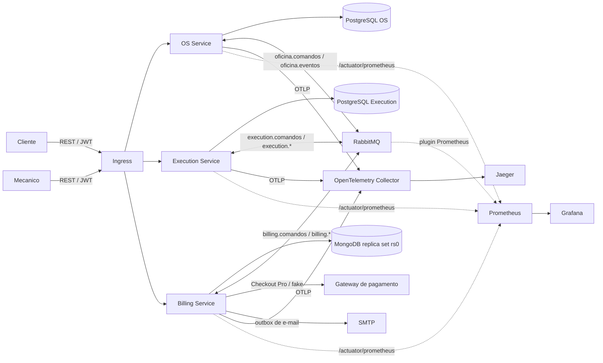
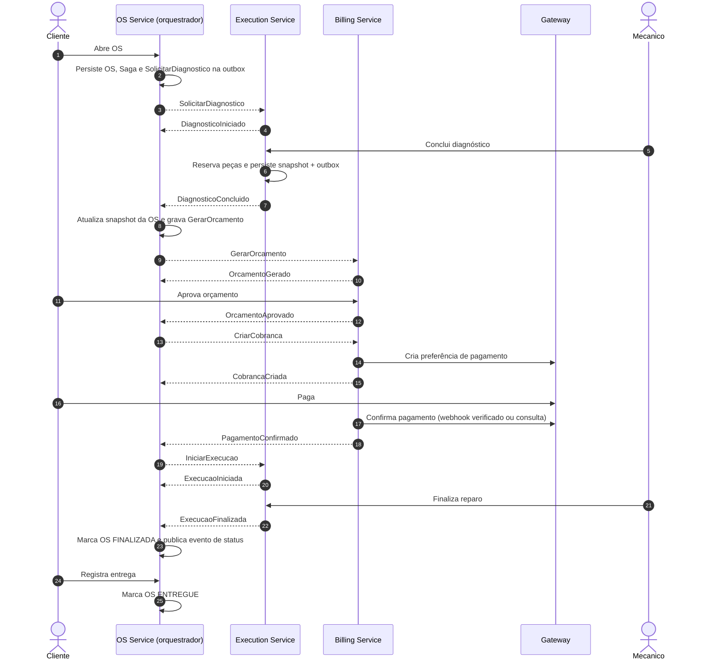
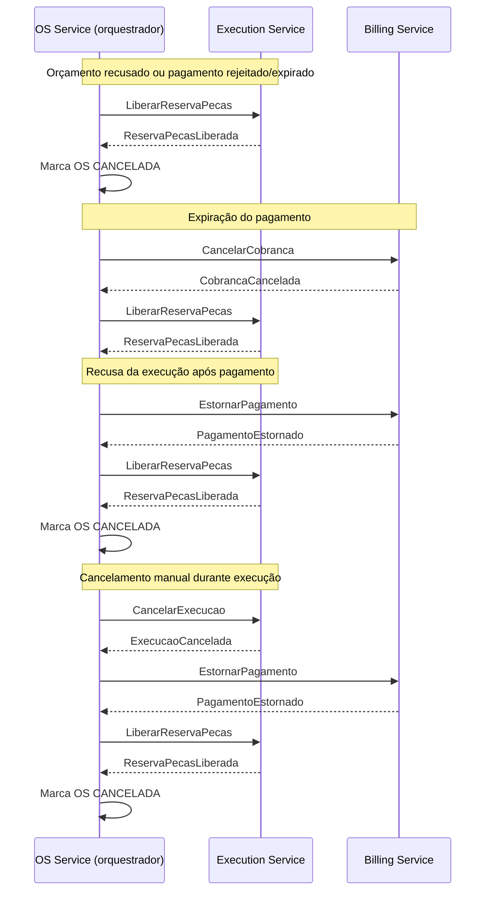

# Arquitetura da Fase 4

## Visão geral

Cada serviço é dono dos seus dados. As mensagens seguem contratos versionados, são gravadas pelo
Transactional Outbox e processadas com inbox/idempotência. O OS Service é o orquestrador e a fonte
oficial do status da ordem de serviço. Decisões: [ADR 0004](./adrs/0004-divisao-em-microsservicos.md),
[ADR 0005](./adrs/0005-saga-orquestrada.md), [ADR 0006](./adrs/0006-rabbitmq-como-mensageria.md),
[ADR 0007](./adrs/0007-mongodb-no-billing.md) e [ADR 0009](./adrs/0009-outbox-e-idempotencia.md).
Visão completa, com filas, DLQs, réplicas, observabilidade e pipeline de entrega:
[arquitetura_geral.mermaid](./arquitetura_geral.mermaid).

## Sequência do caminho feliz

## Compensações

Os contratos completos, payloads, filas, roteamento e fixtures ficam em
[contratos_mensagens.md](./contratos_mensagens.md). Os diagramas descrevem o fluxo implementado; uma
captura de trace distribuído e a validação do fluxo real dependem de executar a plataforma.
