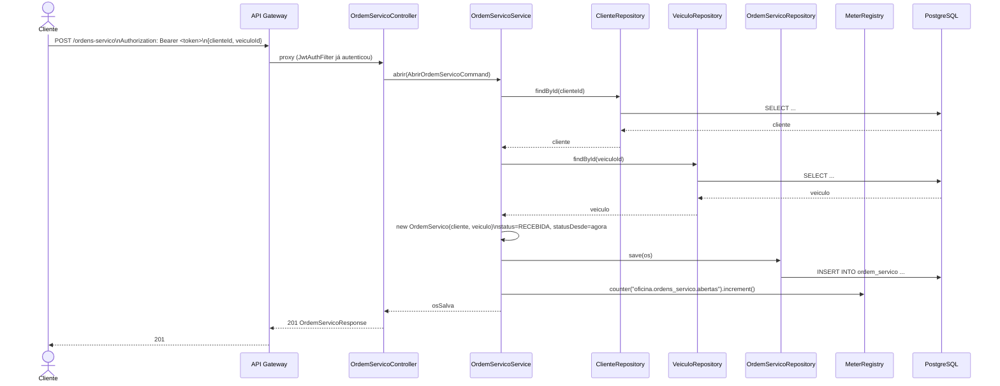

# Diagrama de Sequência — Abertura de Ordem de Serviço

Fluxo de `POST /ordens-servico`, a partir de um cliente já autenticado (ver
`documentacao/diagrama_sequencia_auth.md`). O OS Service recebe somente cliente
e veículo; o diagnóstico, catálogo e reserva de estoque pertencem ao Execution
Service. A publicação do comando `SolicitarDiagnostico` e o consumo de
`DiagnosticoConcluido` serão conectados na Fase 5, quando a Saga for ativada.

## Pontos de decisão relevantes

- **Sem acesso ao banco alheio**: o OS Service não consulta nem atualiza o
  catálogo do Execution Service. A Saga publicará `SolicitarDiagnostico` após a
  abertura; o snapshot de diagnóstico será salvo quando receber o evento.
- **`statusDesde` != `atualizadoEm`**: `statusDesde` só muda em transições de
  status (`avancarStatus`, `responderOrcamento`, `atualizarStatusExterno`); é
  o campo usado para calcular a métrica
  `oficina_ordens_servico_tempo_no_status_seconds` (ver
  `documentacao/infraestrutura.md`, seção de observabilidade).
- **Métrica de negócio no mesmo fluxo transacional**: o incremento do counter
  `oficina.ordens_servico.abertas` acontece antes do `save` final, mas não
  depende dele — Micrometer não participa da transação JPA (se o `save` final
  falhar e o rollback ocorrer, o contador já incrementado não é desfeito; é
  uma imprecisão aceita, não uma garantia de exatidão contábil).
